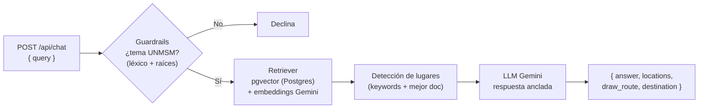

# ⚙️ Backend — OndeSanMarcos (Asistente RAG)

API del **asistente IA del campus** basada en **RAG (Retrieval-Augmented Generation)**.
Implementa el endpoint `POST /api/chat` que **ya consume el frontend** (la app apunta
por defecto al backend desplegado en Render). En **producción** corre con **LLM real
(Gemini `gemini-2.5-flash`)** sobre el **corpus oficial** del campus y **recuperación
semántica con pgvector** (Postgres + embeddings Gemini `gemini-embedding-001`, 768
dims, similitud coseno HNSW). Si `DATABASE_URL` no está definida, cae con gracia a una
recuperación **local** (bag-of-words). Para desarrollo y pruebas también corre
**aislado en modo mock** (embeddings + LLM deterministas, sin llaves ni servicios
externos).

> Diseño y contexto general: ver [`/documents/03-backend-rag.md`](../documents/03-backend-rag.md).

---

## 🧩 Arquitectura

```
backend/
├── app/
│   ├── main.py            # FastAPI: /health + router del chat
│   ├── config.py          # Settings (pydantic-settings): RAG_USE_MOCK, top_k, umbral, DATABASE_URL...
│   ├── api/chat.py        # POST /api/chat  → motor RAG
│   ├── schemas/chat.py    # ChatRequest / ChatResponse / LocationResult / Coordinate
│   ├── knowledge/         # base de conocimiento
│   │   ├── places.py      #   lugares del campus (37, espejo del front)
│   │   ├── corpus.py      #   corpus oficial (41 docs, derivado de sources/unmsm_info.md)
│   │   ├── entries.py     #   entradas aprobadas (respaldo versionado del conocimiento)
│   │   ├── entries/       #   JSON de entradas (gaps_review.json)
│   │   └── sources/       #   documento oficial verificado (fuente única)
│   └── rag/               # motor RAG
│       ├── guardrails.py       #   filtro de alcance UNMSM: léxico + raíces (HU-2.4)
│       ├── intent.py           #   intención de navegación (HU-2.3)
│       ├── embeddings.py       #   mock bag-of-words + Gemini real (gemini-embedding-001)
│       ├── vector_store.py     #   almacén vectorial en memoria (coseno, usado por el mock)
│       ├── pgvector.py         #   retriever real: Postgres pgvector (match_documents)
│       ├── ingestion.py        #   pipeline de ingesta (carga, troceado, embeddings)
│       ├── retriever.py        #   indexa por fragmentos + recuperación top-k
│       ├── llm.py              #   mock anclado al contexto + Gemini/OpenAI/Anthropic reales
│       ├── providers.py        #   selección de proveedores mock vs reales
│       ├── engine.py           #   orquestación del pipeline
│       ├── ingest_pgvector.py  #   ingesta a Postgres (corpus + entradas → pgvector)
│       ├── find_gaps.py        #   detecta lugares sin descripción y redacta borradores (Gemini)
│       └── upload_entries.py   #   sube entradas aprobadas a Postgres
└── tests/                 # pytest (76): guardrails, retriever, ingesta, pgvector, proveedores, motor, enrutamiento, entradas, endpoint
```

Pipeline de una consulta:



> Sin `DATABASE_URL`, el `Retriever` local (bag-of-words) sustituye al paso
> de pgvector; en modo mock todo el pipeline es determinista (sin red).

---

## 🚀 Puesta en marcha

Requiere **Python 3.11+**.

```bash
cd backend
python -m venv .venv
.venv\Scripts\activate          # Windows  (en Linux/Mac: source .venv/bin/activate)
pip install -r requirements.txt

# Configuración (opcional: por defecto ya corre en modo mock)
copy .env.example .env          # Windows  (Linux/Mac: cp .env.example .env)
```

### Ejecutar la API

```bash
uvicorn app.main:app --reload
```

- Healthcheck: http://localhost:8000/health
- Documentación interactiva (Swagger): http://localhost:8000/docs

### Probar el endpoint

```bash
curl -X POST http://localhost:8000/api/chat ^
  -H "Content-Type: application/json" ^
  -d "{\"query\": \"horario de la biblioteca\"}"
```

Respuesta:

```json
{
  "answer": "La Biblioteca Central Pedro Zulen abre de lunes a viernes de 7:30 a 20:00 y los sábados de 8:00 a 17:00. Toca \"Ver en mapa\" para ubicarlo.",
  "locations": [
    { "id": "biblioteca-central", "name": "Biblioteca Central Pedro Zulen", "schedule": "Lun–Sáb 8:00–20:00 · Requiere carné de biblioteca · Tel: 619-7000 anexo 7701" }
  ],
  "draw_route": false,
  "destination": null
}
```

### Ejecutar las pruebas

```bash
pytest                      # unitarias (sin red, sin base, sin Gemini)
```

Con `DATABASE_URL` definida también corren las pruebas de **integración**
(`tests/integration/`) contra Postgres. Crean su propia base `<nombre>_test`, le
aplican las migraciones y la borran al terminar: **nunca tocan la base de
desarrollo**. Sin `DATABASE_URL` se omiten.

---

## 🗄️ Base de datos (Postgres + pgvector)

La recuperación semántica usa un Postgres con la extensión **pgvector**. En
desarrollo corre en Docker; el esquema lo crea **Flyway** con migraciones SQL
versionadas en `db/migrations/` (`V1__pgvector_schema.sql`: extensión `vector`,
tabla `documents`, índice HNSW y la función `match_documents`). Una migración ya
aplicada no se edita: un cambio va en una migración nueva (`V2__...sql`).

Desde la raíz del repo, con Docker:

```bash
./script/dev.sh                 # base de datos + migraciones + backend + web
./script/dev.sh ingest          # embebe el corpus (55 fragmentos) y lo carga en la base
./script/dev.sh psql            # consola SQL
./script/dev.sh db-dump         # copia de seguridad de los vectores (backend/db/dumps/)
./script/dev.sh db-restore      # restaura el último dump, sin llamar a Gemini
./script/dev.sh db-reset        # BORRA la base y la recrea vacía (pide confirmación)
```

Para usar los vectores hay que poner `RAG_USE_MOCK=false` en `backend/.env` (con
`LLM_PROVIDER=gemini` y `LLM_API_KEY`) y haber ingerido el corpus. Si la tabla está
vacía, `POST /api/chat` responde **503** con «La base de conocimiento está vacía;
ejecuta ./script/dev.sh ingest». Si la base no responde, también **503**.

### Cuidar la cuota de Gemini

Cada fragmento necesita una llamada de embeddings, y cada consulta del chat hace
otra, además de la que redacta la respuesta. Por eso:

- La base **no se borra por accidente**: `down` y `clean` la conservan; solo
  `db-reset` la borra, y pide confirmación.
- `ingest` se **niega a sobrescribir** una tabla con datos salvo `--force`.
- Los embeddings se guardan en `backend/.rag_cache/` (ignorada por git): reingerir
  un texto sin cambios **no vuelve a llamar a Gemini**. Al terminar, `ingest`
  indica cuántos se pidieron a Gemini y cuántos vinieron de la caché.
- Ante un error de límite (429/5xx) se reintenta con espera creciente (1, 2, 4,
  8, 16 s). Si se agota, la ingesta falla **sin tocar la tabla**; lo ya embebido
  queda en la caché.
- Las consultas repetidas se resuelven desde una caché en memoria.
- `db-dump` guarda los vectores en un archivo: sirve de respaldo y para
  restaurarlos sin gastar cuota.

### Variables

| Variable | Para qué |
|---|---|
| `DATABASE_URL` | Cadena de conexión. En Docker la fija `docker-compose.yml` (host `db`); fuera de Docker usa `localhost:5432` (ver `.env.example`) |
| `DB_CONNECT_TIMEOUT` | Segundos máximos para conectar antes de responder 503 (por defecto 3) |

---

## 🔌 Contrato del chat

| Método | Ruta | Body | Respuesta |
|--------|------|------|-----------|
| `POST` | `/api/chat` | `{ "query": string }` | `{ "answer", "locations": LocationResult[], "draw_route": bool, "destination": Coordinate? }` |
| `GET`  | `/health` | — | `{ "status": "ok", ... }` |

`LocationResult = { id, name, schedule? }` · `Coordinate = { latitude, longitude }`.
Para consultas de navegación ("cómo llego a…"), `draw_route` es `true` y
`destination` trae las coordenadas del lugar (HU-2.3). El **frontend ya consume este
endpoint por defecto** (apunta al backend de Render; el mock del chat solo se activa
con `EXPO_PUBLIC_USE_MOCK_CHAT=true`).

---

## 🔁 Modo mock vs. proveedores reales

Controlado por `RAG_USE_MOCK` (ver `.env.example`):

| | Modo mock (`true`, tests/local) | Modo real (`false`, **producción**) |
|---|---|---|
| Embeddings | `BagOfWordsEmbedding` (sin deps) | **Gemini** `gemini-embedding-001` (768 dims) *(activo)* |
| LLM | `TemplateLLM` (anclado al contexto) | **Gemini** `gemini-2.5-flash` (u OpenAI/Anthropic) *(activo)* |
| Recuperación | en memoria (bag-of-words) | **Postgres + `pgvector`** (coseno HNSW) · local si falta `DATABASE_URL` |
| Requisitos | `requirements.txt` | + `requirements-llm.txt` (Gemini) + `requirements-pgvector.txt` (Postgres); `LLM_API_KEY` y `DATABASE_URL` |

La selección de implementaciones vive en `app/rag/providers.py` (la usa
`engine.build_engine`). Si en modo real falta una llave o dependencia, se lanza
`RagProviderError` y el endpoint responde **503** con instrucciones. Guía
completa de activación en
[`/documents/07-avance-backend.md`](../documents/07-avance-backend.md).
